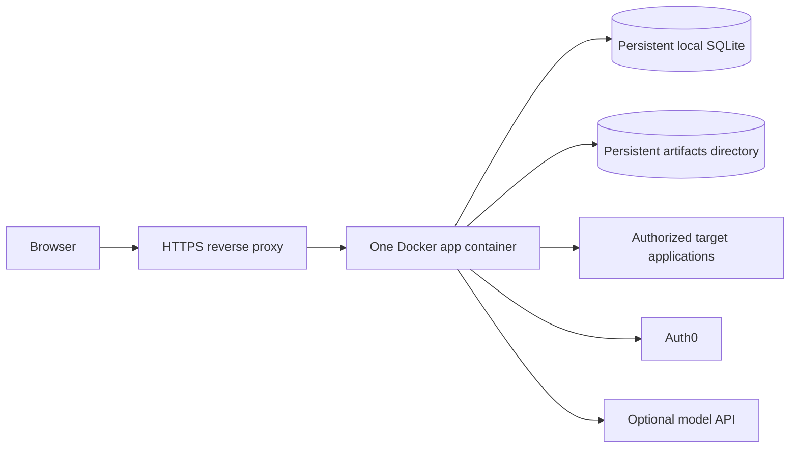

# Free deployment plan

**Status:** Render Free is the selected temporary POC target. The service is not deployed yet. This workspace has no Git repository or Render account connection, which Render needs to build from source.

This POC accepts disposable data and brief cold starts. “Free” hosting changes over time and may require an account with a payment method. Recheck the official plan terms before provisioning. This is suitable for a personal demo, not a production service with an uptime or recovery guarantee.

## Temporary Render POC

The repository now includes a Render Blueprint at `render.yaml`. Connect the Git repository in Render and create a Blueprint deployment from that file. It builds the existing Dockerfile, listens on Render's assigned port, and checks `/api/health`.

Render Free sleeps after 15 minutes idle and has an ephemeral filesystem, so the SQLite database, discoveries, and evidence artifacts are lost on restarts, redeploys, and spin-down. It has 0.1 CPU and 512 MB RAM; live Chromium discovery may exceed those limits. Use it to evaluate the interface and short, disposable demos. Do not put any data there that must be kept. See [Render free services](https://render.com/docs/free) and [compute plans](https://render.com/docs/compute-plans).

Before login works, set the Auth0 domain, client ID, client secret, and session secret in Render. After Render assigns the public URL, add `<public-url>/auth/callback` to the Auth0 Allowed Callback URLs and `<public-url>` to Allowed Logout URLs and Allowed Web Origins. The app uses Render's `RENDER_EXTERNAL_HOSTNAME` value for the Auth0 origin and host checks. Add `OPENAI_API_KEY` to enable the project assistant.

The Blueprint marks these values `sync: false`, so they are supplied through Render's secret environment settings and are not stored in the repository. Never copy `.env` or `.env.local` into the deployment.

### Start deployment

1. Push this project to a GitHub or GitLab repository if it is not already hosted there.
2. In Render, choose **New → Blueprint**, connect that repository, and deploy `render.yaml`.
3. Supply the Auth0 settings in Render and complete the callback/origin entries in Auth0 using the assigned `onrender.com` URL.
4. Wait for `/api/health` to pass, then sign in and check the dashboard.

Render's dashboard requires an authenticated provider session to connect a repository and create the service. No provider session or Git remote is available in the current workspace, so these external steps remain outstanding.

## Persistent single-host option

Use an **Oracle Cloud Always Free Ampere A1 Linux VM** as the first candidate if capacity is available in the selected home region. Current Always Free limits include 2 OCPUs and 12 GB of memory across A1 instances, plus 200 GB of combined boot/block storage and up to five volume backups. New instances are created in the tenancy's home region. Oracle may reclaim an A1 instance after seven days if CPU and network use stay below 20% and memory stays below 20%; a lightly used demo may meet that condition. Capacity errors can also prevent provisioning in a region, and Always Free accounts have no SLA. Check the [Always Free resource limits](https://docs.oracle.com/en-us/iaas/Content/FreeTier/freetier_topic-Always_Free_Resources.htm) and [Free Tier FAQ](https://www.oracle.com/cloud/free/faq/) before relying on it.

The A1 candidate fits the current single-process, Chromium, and persistent-filesystem architecture better than a free ephemeral web-service tier. Playwright documents Chromium support on Linux ARM64, but the current project Docker image still needs to be built and exercised on the chosen A1 host before deployment is considered ready. See the [Playwright system requirements](https://playwright.dev/docs/intro) and [Docker guidance](https://playwright.dev/docs/docker).

### Why not use a free Render web service for the full app?

Render's free web services currently have 0.1 CPU and 512 MB RAM, spin down after 15 idle minutes, and lose local filesystem changes on restart/redeploy. They cannot attach persistent disks. That conflicts with this app's SQLite database, artifacts, and memory-intensive browser process. Render's free Postgres currently expires after 30 days and does not solve the local artifact filesystem requirement. A free Render service could host a disposable evaluation where data loss is acceptable, but it is not an appropriate home for persistent Unfold discoveries. See [Render free services](https://render.com/docs/free), [compute plans](https://render.com/docs/compute-plans), and [persistent disks](https://render.com/docs/disks).

## Proposed topology

- One Linux ARM64 VM and one Docker app instance.
- One reverse proxy (Caddy or Nginx) handles HTTPS and forwards to the app on loopback port `4310`.
- The app's `.local` and `artifacts` directories live on persistent VM storage.
- No second application replica, shared network filesystem, external queue, or managed database in the first deployment.
- Auth0 remains the identity provider; the OpenAI-compatible API key is optional and stays server-side.
- Chromium work runs inside the app container. Start with concurrency `1` and conservative discovery budgets; lower the generic `maxBrowserMemoryMB` and `maxBrowserCpuPercent` defaults to match measured host capacity.

This matches the store's single-writer SQLite model and avoids splitting the source of truth across services. It also means a VM outage pauses the whole application until that VM is restored.

## Deployment steps

### Phase 1: make the app deployment-ready

1. Confirm the Docker image builds and Chromium launches on Linux ARM64 with the pinned Playwright version.
2. Use persistent paths for `UNFOLD_DATA_DIR` and `UNFOLD_ARTIFACT_DIR`; keep both on the VM's persistent block volume.
3. Set `HOST=0.0.0.0` and let the host proxy provide public HTTPS. Configure `PORT` consistently with the app container and reverse proxy.
4. Keep only one server process writing to the SQLite database. Do not add a second replica.
5. Add an operator-run backup/restore procedure for the SQLite database and artifacts. Verify a restore on a separate directory before storing important discoveries.
6. Set the production `APP_BASE_URL` to the public HTTPS origin and register its exact callback and logout URLs in Auth0.
7. Put Auth0 client secret, session secret, and optional model API key in the host/container's secret environment, never in the dashboard bundle or repository.

### Phase 2: provision the host

1. Create an eligible Always Free A1 instance in the account's home region; verify current quotas and availability before choosing the VM size.
2. Use a supported ARM64 Linux image and Docker Engine. Keep SSH restricted to a known source IP where possible.
3. Expose only SSH, HTTP, and HTTPS through the cloud firewall. Keep the app's `4310` and fixture `4174` ports private to the host/proxy.
4. Attach persistent block storage within the current Always Free quota and keep `.local` and `artifacts` outside the container's writable layer.
5. Install a reverse proxy with automatic TLS. A free DNS hostname may be used for a demo; custom domain registration can still cost money.

### Phase 3: deploy and validate

1. Build the project image from the repository's Dockerfile on the target architecture.
2. Start one container with persistent `.local` and `artifacts` mounts and the production environment variables.
3. Check `/api/health`, Auth0 login/callback/logout, project ownership, artifact downloads, and the assistant model request if enabled.
4. Run a small discovery against Atlas or an authorized disposable target with one worker, a low action/state budget, and safe mode enabled.
5. Restart the container and verify the project, discovery, evidence, and artifact links still load.
6. Export and restore the database/artifact backup in a clean location before using the service for anything that must be retained.

The current `compose.yml` is for local development: ports are bound to loopback, environment is read from local `.env` files, and it also includes the fixture port. Create a production compose override or host service definition rather than exposing the fixture publicly.

## Backups and recovery

The database and artifacts form one logical backup set. A recovery copy must include both, preserve their relationship, and be stored off the VM. SQLite is in WAL mode, so do not copy only the main database file while it is actively being written. Use SQLite's online backup mechanism or stop the app cleanly before copying the database and artifacts together.

Oracle's included five volume backups can help with VM-volume recovery, but a volume backup is not a tested application-level export. Keep a separate encrypted backup outside the host and periodically test restore. Treat VM reclamation, accidental instance deletion, account lockout, full storage, expired secrets, and failed Chromium startup as recovery scenarios.

## Limits and future upgrade path

- OCI Always Free compute can be reclaimed if it meets the provider's idle criteria; free capacity may also be unavailable in the home region.
- The free plan has no service-level agreement or guaranteed support. Use for evaluation and demos only.
- Chromium scans can temporarily use substantial CPU and memory. A free VM may need low concurrency and strict budgets.
- A public deployment of an authorized discovery tool should be access-controlled. Do not expose unauthenticated project APIs or the fixture.
- Auth0, model API usage, DNS/domain, outbound traffic, and any resource beyond free quotas can incur cost.
- SQLite and local artifacts keep the deployment simple but constrain it to one writer/host.

If the project needs reliable uptime or multiple users depending on it, move to paid compute with persistent storage and automated backups. If it needs multiple app replicas, first migrate durable state to a supported shared database and artifact store, then replace the local leasing assumptions. Do not scale this SQLite deployment by adding replicas.

## Current facts checked

Provider limits and supported architectures were checked on **October 13, 2026**. Verify the links above again before provisioning because free tiers and quotas can change.
