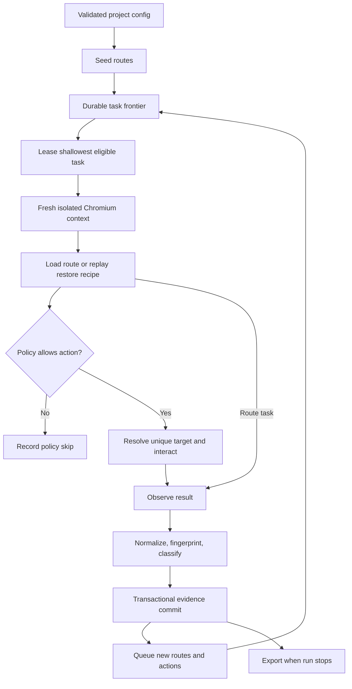

# Discovery engine

This guide follows one discovery from configuration through browser work and persistence. It expands the lifecycle in the [platform guide](platform-guide.md); source of truth for configuration and records remains `packages/shared/src/index.ts`.

## Engine at a glance

The coordinator is in `packages/core/src/index.ts`. Browser behavior is in `packages/worker/src/index.ts` and `packages/worker/src/observe.ts`. Policy, URL normalization, fingerprints, effect labels, and locator expressions are in `packages/core/src/policy.ts` and `packages/analysis/src/index.ts`.

## 1. Configuration and seed scope

`ConfigSchema` applies defaults and validates the full discovery configuration before it is stored or executed. A configuration includes:

- The base URL, seed URLs, and exact additional origins.
- Depth, state, action, elapsed-time, per-action timeout, and concurrency limits.
- Safe mode, dry-run mode, denied action words, URL filters, and explicit action/form/network-write allowlists.
- Synthetic field values, viewport, screenshots, failure traces, and target-specific redaction selectors.
- Browser CPU and memory pressure thresholds.

If there are no explicit seeds, the base URL becomes the seed. A seed must be inside an allowed origin. Credential-like values in a seed URL are rejected; authentication belongs in a Playwright storage-state file. Wildcard origins are not accepted.

The coordinator loads `/robots.txt` for approved origins before exploration. Robots disallows and crawl delay are enforced. Redirects and browser requests remain within the configured origin boundary; service workers and WebSockets are blocked for worker contexts.

## 2. The frontier and task identity

The frontier is the persisted `tasks` table. There are two task kinds:

| Task     | Purpose                                                               | Input                                                           |
| -------- | --------------------------------------------------------------------- | --------------------------------------------------------------- |
| `route`  | Open a seed or discovered internal link and observe its initial state | URL and depth                                                   |
| `action` | Restore a known state and activate one discovered control             | State ID, element ID, action type, optional synthetic value key |

The store leases the pending task with the lowest depth, then highest priority, then oldest insertion order. Task keys are unique per discovery. Route keys prevent enqueuing the same URL repeatedly; action keys combine the source fingerprint, element structural signature, and interaction type. Route tasks get a higher priority than ordinary controls within the same depth.

Every leased task has an attempt count, worker number, and expiry. Startup recovery returns abandoned leases to pending. Failed probes can retry once; retries retain the original task identity and are pushed behind fresh work.

## 3. Isolated browser work

The coordinator starts one Chromium process per running discovery and schedules up to the configured concurrency. Each task receives a fresh browser context, configured viewport, and an optional cloned Playwright storage state. This isolates page and browser context state between workers, but all contexts may still share the target application's backend account and data.

The worker sets finite action and navigation timeouts and a task deadline. Requests outside approved origins are blocked. Navigation to each origin is paced by the greater of the configured interval and robots crawl delay. Browser CPU and RSS are sampled; pressure, repeated failures, or HTTP 429/5xx responses reduce active worker capacity. A memory threshold stops new leasing and lets active work drain.

### Route probe

For a route task, the worker opens the URL, waits for a bounded stable DOM window, observes the state and links, and records any route-level evidence. It does not click every control while it is taking that initial observation.

### Action probe

For an action task, the worker:

1. Loads the recipe seed URL and replays each recorded step.
2. Checks the expected URL and state fingerprint at each step and before the final action.
3. Resolves the target from ranked locator candidates and requires the target to be unique, visible, and enabled.
4. Re-evaluates policy immediately before the interaction.
5. Captures before evidence, performs the click, hover, fill, or select, and waits for the bounded settle period.
6. Captures the destination state and action-window evidence, then closes the context.

When a popup is opened, the worker records logical parent/child tab lineage. These IDs describe relationships in the discovery graph; they are not persistent operating-system browser tabs.

## 4. Policy and forms

Policy is evaluated when controls are expanded from an observation and again by the worker before execution. Disabled controls, out-of-scope links, denied URL patterns, high-risk keywords, form submissions without exact approval, and unknown controls in safe mode are skipped with a persisted reason.

Safe exploration supports in-scope navigation, semantic UI disclosures and selections, and non-committing hover probes. Unknown controls can be allowed with an exact route/control approval. `dryRun` records routes and policy decisions without activating controls.

Form fields are filled only when a matching route and accessible label have a configured synthetic value. A submit control stays blocked until its form's configured values are filled and its exact route/control pair is allowed. POST, PUT, PATCH, and DELETE requests are blocked unless the exact request URL and method are allowlisted. A run with any network-write allowlist has an effective worker limit of one.

Policy records the rule and reason, not an inferred user intention. A skipped action is visible evidence of a decision, not evidence that the target application's action would have succeeded.

## 5. Observation, identity, and effects

The observer captures a `state`, `elements`, `components`, outgoing links, and observation time. An element can include accessible semantics, form/selection state, geometry, and ordered locator candidates. A component records its root locator, contained elements, classification evidence, and confidence.

State identity combines a normalized URL, structure tokens, and stable main text. Tracking parameters are removed; sensitive query values are redacted. Dates, times, generated IDs, and whitespace are normalized in stable text. The engine first compares the fingerprint, then uses a conservative equivalence check that requires the same URL and structure inventory plus more than 98.5% token overlap.

Action effects are a set of labels, not a single business result. They can record navigation, modal/drawer/menu openings, tab selection, expansion, form reveal, content change, download, new tab, or no observed change. Browser request/response events and in-scope fetch/XHR evidence can be linked to the action and source/destination states.

Locator candidates include semantic role/name, label, test ID, placeholder, text, and CSS strategies. Uniqueness is checked during observation; replay verification records whether a candidate resolves again after restoring the state. Code generation only emits verified candidates.

## 6. Commit, limits, and resume

The coordinator commits an observation, canonical state link, action edge, API calls, verified elements/components, frontier expansion, and task status inside one SQLite transaction. A duplicate state points the action to its canonical stored state and does not expand the same observation again.

The run tracks `queued`, `running`, `pausing`, `paused`, `completed`, `limited`, and `failed` states. Pause changes a running discovery to `pausing`; active tasks drain before the final `paused` status is stored. When the process resumes a discovery, it recovers leased tasks before scheduling again.

Budgets behave differently:

- **Depth** limits further route/action expansion; a state at the limit is still retained.
- **State count** limits newly committed nodes. If an in-flight action observes a new destination after the state budget is reached, its task remains pending for a later resume.
- **Action count** counts leased action attempts, including retries. Policy skips do not consume an action attempt.
- **Duration** stops new task leasing after active work drains.
- **Resource limits** can reduce concurrency or stop new work while retaining the frontier.

When the frontier is exhausted, the discovery is completed. If pending work remains after a limit or a process recovery, it stays resumable. Exports are refreshed when the coordinator exits normally.

## 7. How to reason about incomplete evidence

- An absent route may be outside the seed/link frontier, blocked by policy, hidden behind authentication, or beyond a budget.
- An absent transition does not prove the control has no effect; the action may have been skipped, failed to restore, or produced an unobserved effect.
- A recorded API call is a captured request/response sequence, not proof of server-side business success.
- A verified locator resolved against one restored observation; target updates can invalidate it later.
- A fixture benchmark validates a fixed fixture and budget, not exhaustive behavior for arbitrary applications.

Use the [system design guide](system-design.md) for cross-package ownership and the [validation guide](validation.md) for the checks around this lifecycle.
