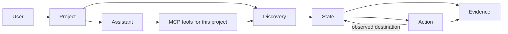
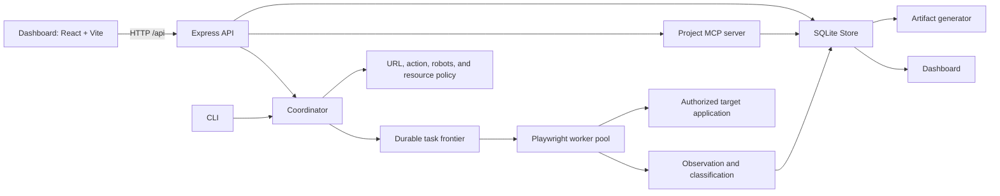

# Unfold platform guide

This guide gives a new contributor one path through the product, runtime architecture, discovery process, evidence model, and codebase. It describes the implementation in this repository. For setup commands and the full configuration reference, see the [root README](../README.md); for canonical domain language, see the [glossary](../CONTEXT.md).

For deeper dives, see the [discovery engine guide](discovery-engine.md), [system design](system-design.md), and [setup guide](setup.md). The [free deployment plan](deployment-free.md) is a proposal, not a configured production environment.

## 1. What the platform is

Unfold explores an authorized web application in a real Chromium browser. It records what it can observe, builds a graph of interface states and interactions, and presents that evidence in a dashboard. It can also export Playwright helpers based on locators verified during state restoration.

The product has four connected parts:

1. **Projects** keep one target application, its discovery history, scan configuration, and project-specific assistant context together.
2. **The discovery engine** restores observed states, applies policy, interacts with the target application, and records outcomes.
3. **The dashboard** lets people inspect projects, discoveries, routes, states, controls, components, interactions, API evidence, and generated artifacts.
4. **MCP and the project assistant** make evidence from one project available to an external MCP client or the in-app chat. The assistant can request a new browser discovery through a project tool.

Unfold records evidence; it does not know the target application's intended business rules. An observed transition, component family, API response, or successful locator should not be treated as proof of business correctness.

## 2. Product and domain model

The primary relationship is:

| Concept    | Meaning in Unfold                                                     | Where it appears                      |
| ---------- | --------------------------------------------------------------------- | ------------------------------------- |
| Project    | Scope for one target application origin and its work                  | Dashboard, API, storage, MCP          |
| Discovery  | One bounded exploration; represented as `Run` in code                 | Engine, discovery list, exports       |
| Route      | Normalized URL location                                               | Route index and route views           |
| State      | Observed page or interface condition                                  | Graph node, screenshot, state catalog |
| Action     | Attempted control interaction with policy and result                  | Graph edge, action catalog            |
| Transition | Action-linked source-to-destination state relationship                | Flow graph and journey views          |
| Element    | An observed interactive control and locator candidates                | Controls, components, action evidence |
| Component  | A semantic or structural UI region inferred from DOM evidence         | Component catalog and reuse views     |
| Evidence   | Screenshot, state/action record, browser event, API call, or artifact | Inspector, report, MCP results        |

An action does not always create a transition. It can be skipped by policy, fail during replay or interaction, or produce no observed change. In a flow diagram, `A -- click "My Cart (0)" --> B` means an action from state A led to observed state B; the arrow does not mean the engine knows why the application made that change.

### Project scope

A project stores its name, description, base URL, validated scan configuration, assistant instructions, and archive metadata. Discoveries are attached to a project and must use the same base origin. The authenticated server filters project and discovery access by the Auth0 subject. A project's MCP endpoint validates that requested discovery IDs belong to that project.

User preferences are separate from project configuration. They include theme, palette, font, and global discovery defaults. When a new discovery is started through the dashboard or assistant, project configuration and global defaults are combined and validated. Project deny keywords are retained when defaults are merged.

## 3. Runtime architecture

The production server serves the dashboard assets and API from one process. In development, Vite serves the dashboard separately and proxies API requests to the server. `npm run dev` also starts the Atlas fixture application. The CLI uses the same shared schemas, coordinator, storage, worker, and generator packages as the server.

### Workspace map

| Path                                             | Responsibility                                                                           | Start here when changing…                             |
| ------------------------------------------------ | ---------------------------------------------------------------------------------------- | ----------------------------------------------------- |
| `apps/dashboard/src/main.tsx`                    | React routes, project/dashboard screens, discovery views, assistant, MCP setup, settings | Product screens, navigation, user-facing interactions |
| `apps/dashboard/src/styles.css` and `flow-*.css` | Dashboard theme, layout, and flow view styling                                           | Visual system, responsive layout, graph view styles   |
| `apps/server/src/index.ts`                       | Express API, project/discovery orchestration, assistant model/tool loop, artifact routes | HTTP behavior and app orchestration                   |
| `apps/server/src/auth.ts`                        | Auth0 login, token verification/refresh, encrypted server sessions                       | Authentication and session lifecycle                  |
| `apps/cli/src/index.ts`                          | `appscan` commands for run, auth, list, pause, resume, export, MCP                       | CLI behavior                                          |
| `packages/shared/src/index.ts`                   | Zod schemas and TypeScript domain contracts                                              | Any persisted or cross-package data shape             |
| `packages/core/src/index.ts`                     | Coordinator, queue expansion, worker scheduling, budgets, run lifecycle                  | Discovery scheduling and commit behavior              |
| `packages/core/src/policy.ts`                    | Origin, URL, action, form, and safe-mode decisions                                       | Action safety or URL scope                            |
| `packages/core/src/robots.ts`                    | Per-origin robots rules and crawl delay                                                  | Robots behavior and navigation pacing                 |
| `packages/core/src/resources.ts`                 | Browser process resource sampling and pressure response                                  | Adaptive concurrency and resource limits              |
| `packages/worker/src/index.ts`                   | Browser context setup, route/action probes, event and API capture                        | Real browser interaction behavior                     |
| `packages/worker/src/observe.ts`                 | Observation, locator resolution, verification, stabilization                             | State capture and locator checks                      |
| `packages/worker/src/browser-evidence.ts`        | Value-limited browser snapshots and isolated persistence probes                          | Browser lifecycle evidence                            |
| `packages/analysis/src/index.ts`                 | URL normalization, redaction, fingerprints, equivalence, effects, locator expressions    | Evidence identity/classification                      |
| `packages/storage/src/index.ts`                  | Node SQLite schema, transactions, migrations, projects, runs, evidence, task leases      | Persistence and ownership boundaries                  |
| `packages/generator/src/index.ts`                | JSON, reports, TypeScript page/component helpers                                         | Export format and generated helpers                   |
| `packages/mcp/src/server.ts`                     | Project MCP tools, resources, prompts, transports                                        | MCP surface or project assistant tools                |
| `packages/mcp/src/stdio.ts`                      | Local stdio MCP entry point                                                              | External stdio MCP client startup                     |
| `apps/fixture`                                   | Atlas test application                                                                   | Controlled discovery scenarios                        |
| `scripts/` and `tests/`                          | Demo, benchmark, generated-code checks, integration/hardening checks                     | Validation harnesses and regression coverage          |

The imports use source-relative paths across workspaces. The root `tsconfig.engine.json` compiles the Node engine into `dist/engine`; Vite bundles the dashboard into `dist/dashboard`.

## 4. Discovery lifecycle

### From setup to a saved result

1. **Create or select a project.** The target URL defines the project origin. The project provides per-target scan settings and assistant instructions.
2. **Create a discovery.** `ConfigSchema` validates the URL, seeds, allowlisted origins, policy, limits, viewport, and evidence settings. Credential-bearing seed URLs are rejected; saved browser storage state is the supported authentication input.
3. **Create the run and seed the frontier.** A queued run stores its full configuration. The coordinator loads robots rules, queues the seed URLs, starts Chromium, and begins bounded resource sampling.
4. **Lease work.** Tasks are prioritized by shallowest depth, then priority. Route probes discover new reachable pages; action tasks target controls discovered in prior observations. Unique task keys prevent duplicate frontier entries.
5. **Restore the starting state.** Each task gets an isolated browser context. The worker replays a stored recipe and checks the expected fingerprint before acting. If the page cannot be restored reliably, the task records a failure rather than treating a different page as the target state.
6. **Decide whether to act.** The policy checks origin, denied URL patterns, disabled state, form submission rules, deny keywords, dry-run mode, synthetic values, semantic UI patterns, and safe mode. A skip is persisted with its rule and explanation.
7. **Interact and observe.** For an allowed task, Playwright resolves a unique visible locator, captures the pre-action observation, activates the control, waits for a bounded settle period, and records the resulting state, browser events, API calls, timing, and screenshots when enabled.
8. **Analyze and commit.** URL normalization and fingerprinting identify duplicate states conservatively. The coordinator commits observations, actions, API calls, queue expansion, and task completion in one SQLite transaction.
9. **Inspect or resume.** The run can finish, hit a depth/state/action/time/resource budget, pause, or fail. Leased tasks are recovered on restart. Remaining frontier tasks can be resumed when the run is resumable.
10. **Export.** JSON evidence, a standalone HTML report, and generated TypeScript helpers are written under the artifact directory.

### What a state represents

A state is more than a URL. The worker captures the normalized URL, title, visible semantic regions, interactive element inventory, structure tokens, main text, and a screenshot when enabled. It captures meaningful interface conditions such as a dialog, expanded disclosure, selected tab, or changed content as distinct states when the fingerprint changes.

Exact fingerprint matches are checked first. The conservative similarity fallback requires the same URL and structure token inventory and more than 98.5% stable-text token overlap. This favors keeping distinct UI conditions over merging uncertain matches. Every state stores a fingerprint version and reason to make its identity traceable.

### What an action represents

An action records the source state, target element, attempted interaction, policy decision, effects, optional destination state, evidence paths, confidence, and errors. Effects are descriptive flags such as `navigate_same_tab`, `open_modal`, `switch_tab`, `download`, `submit_form`, or `no_observed_change`. They describe browser evidence; they do not declare the application's business intent.

### Durable work and budgets

Tasks have persisted identities, attempts, status, worker number, and leases. The queue is stored in SQLite, so a process restart can put abandoned leases back on the pending frontier. State, action, time, and browser resource limits stop or reduce work while preserving resumable tasks where possible. The action budget counts attempted action tasks including retries; policy skips do not spend a browser action attempt. Network write allowlists serialize browser work to one effective worker to reduce interference on a shared backend.

## 5. Safety, privacy, and evidence quality

Discovery defaults to conservative safe mode. Internal navigation and semantic disclosures can be explored; unknown controls are skipped. High-risk action names and form submission require exact route/control approval. Form entry only uses configured synthetic values. POST, PUT, PATCH, and DELETE requests are blocked unless an exact URL and method are approved. Use an authorized disposable test environment: browser context isolation does not isolate accounts or backend data.

All navigation and replay requests are restricted to the base origin plus exact configured origins. Robots rules are loaded at run start; disallowed paths and crawl delays are enforced. Service workers and WebSockets are blocked during discovery. Resource pressure, rising action failures, and server error responses can reduce concurrency; reaching the memory threshold stops new leases and drains active work.

Evidence capture uses explicit redaction and bounded fields:

- Screenshots mask inputs, textareas, `[data-private]`, and `[data-sensitive]` by default; projects can add `redactSelectors`.
- URLs are normalized and sensitive query values are redacted in public configuration and exported browser evidence.
- API headers and body fields matching sensitive names are redacted, and bodies have a size limit.
- Failure traces retain action timing while omitting network payloads, snapshots, and console payloads.
- Browser lifecycle records use fixed event categories and value-free counters rather than capturing arbitrary page text or entered form values.

Redaction is not a guarantee that every application-specific secret is removed. Inspect generated artifacts before sharing them and add target-specific selectors when needed.

## 6. Dashboard and interaction design

The main dashboard is project-oriented. The top navigation centers the primary destination, **Dashboard**; project selection and creation sit beside it. Project pages focus on discovery lists. Discovery details use a compact header with the breadcrumb and actions, then a tabbed workspace for exploring the captured evidence. MCP and Assistant open as full-screen project tools; inside the flow explorer, Assistant opens as a right-side drawer so the graph remains in context.

The graph and evidence inspector form the primary analysis layout. Selecting a state or transition opens a drawer that can scroll independently or expand to full screen. The graph supports panning, zooming, route/path selection, filters, and multiple evidence views. Large catalogs use search and pagination; graph nodes outside the viewport are culled. Motion and layout changes should preserve focus and avoid moving the graph unexpectedly.

The visual system is defined in `apps/dashboard/src/styles.css` and view-specific flow stylesheets. Current defaults use IBM Plex Sans for interface copy, Space Grotesk for headings, an ink/slate foundation, teal action color, light canvas/surface layers, and theme/palette/font variables. Keep state distinctions legible through labels and shape as well as color, preserve keyboard focus, respect reduced-motion preferences, and keep dialogs/drawers contained within the viewport.

### Design intent

- **Evidence first:** show what the browser actually observed and link interpretations to the underlying state/action evidence.
- **Progressive detail:** put route or flow overview first, then reveal exact control, request, policy, and screenshot details on selection.
- **Stable context:** inspect evidence in drawers and focused views without losing the active discovery or route.
- **Readable at scale:** use filtering, pagination, semantic zoom, and viewport culling rather than shrinking every node into a thumbnail.
- **Quiet chrome:** keep primary project navigation and discovery actions clear while making the evidence canvas the working surface.
- **Accessible states:** show policy skips, failures, warnings, focus, and selection in ways that do not rely on color alone.

For the current view families and their evidence limits, read the [flow visualization roadmap](flow-visualization-roadmap.md). For persistence and generation decisions, read [architecture and limitations](architecture.md).

## 7. Assistant and MCP

Each project exposes a project-scoped MCP surface. The in-app assistant connects to that project's MCP server for each request, advertises those tools to the configured model, and executes requested tool calls through the MCP client. The UI lets the user choose a supported model; server configuration comes from `OPENAI_API_KEY`, optional `OPENAI_BASE_URL`, and `OPENAI_MODEL`.

The tools cover project overview, discovery listing, state and component search/read, interaction evidence, API call search and ordered API flow, discovery comparison, and starting a new discovery. The MCP surface also provides a project context resource and `project-expert` prompt. After a discovery captures API sequences, `refresh_flow_tools` can register dedicated read-only tools for those observed flows. The stdio transport is available through the CLI for external MCP clients.

The assistant can:

- Answer questions grounded in stored evidence from the selected project.
- Start a new browser discovery asynchronously through `start_discovery`.
- Draft Playwright test code or project prompts in its response using observed locators when available.

The assistant does **not** run arbitrary shell commands, execute arbitrary generated tests, or claim a test passed just because it drafted the code. The browser view reflects a discovery's live state; chat-only requests do not start browser work. Assistant session history is kept in browser `localStorage` under a project-specific key; it is not a server-side conversation database.

For MCP transport details and exact tool registration, see `packages/mcp/src/server.ts`; for the OpenAI-compatible tool loop and streaming response events, see `apps/server/src/index.ts`.

## 8. Data, storage, and generated artifacts

The application uses Node's built-in `node:sqlite` through `DatabaseSync`, with WAL mode and a busy timeout. `.local/unfold.sqlite` is the default database. Tables store projects, runs, states, elements, components, actions, API calls, task leases, events, Auth0 sessions/transactions, and user preferences. Ownership is stored on projects and inherited by project discovery queries. A migration associates older unscoped runs with projects by target origin.

Artifacts live under `artifacts/<discovery-id>/` by default. They include evidence JSON, generated page/component classes, a manifest and TypeScript config, and a searchable standalone HTML report. `UNFOLD_DATA_DIR` and `UNFOLD_ARTIFACT_DIR` can move these locations. Keep one process/runtime responsible for a database; do not have a host process and container write to the same SQLite file concurrently.

Generated page classes include a restore recipe and getters only for locators verified after restore. Generated click helpers reflect observed clicks and may include a URL wait. They do not infer business assertions. Synthetic values are passed by callers and are not embedded in generated source.

## 9. Development and change process

### First run

Use the commands in the [root README](../README.md): install dependencies, install Playwright Chromium, then run `npm run dev`. The Atlas fixture is started by the development command. The UI is at `http://127.0.0.1:5173`; the API is at port `4310`.

### Make a change

1. Identify the owning layer from the workspace map. Avoid implementing the same business rule independently in dashboard, API, and worker.
2. If data crosses a package or is persisted, update the Zod contract in `packages/shared/src/index.ts` first and follow every reader/writer of the shape.
3. Keep policy decisions in `packages/core/src/policy.ts`; keep browser observations and locator verification in `packages/worker`; keep state equivalence and effect classification in `packages/analysis`.
4. Persist related graph changes transactionally through `Store` so an observation, its action/evidence, frontier expansion, and task completion do not become partially committed.
5. Keep project ownership checks on server routes and MCP lookups. Do not trust a project or discovery ID received from a client without validating its scope.
6. Update the relevant docs when changing product language, run lifecycle, evidence semantics, safety boundaries, settings precedence, MCP tools, exports, or the dashboard's main navigation.
7. Run the narrowest relevant validation command, then broader checks when the change crosses layers. The full command list and special fixture requirements are in the [README validation section](../README.md#validation).

### Validation tools

- `npm run typecheck` checks TypeScript contracts across the workspace.
- `npm run build:engine` compiles the Node server, CLI, packages, and scripts.
- `npm run build` runs typecheck, engine compilation, and dashboard production build.
- `npm test` runs Vitest unit tests.
- `npm run test:integration`, `npm run test:hardening`, `npm run demo`, and `npm run benchmark` exercise fixture-backed workflows; some require the fixture or Docker configuration described in the README.
- `npm run test:ui` checks the browser interface against a running app.
- `npm run check:generated` checks generated automation artifacts against the fixture.

### Design review checklist

- Does the change preserve project-level evidence isolation?
- Are observed facts clearly separated from inferred classifications?
- Can the user tell why a control was executed, blocked, or failed?
- Does any new capture field risk recording credentials, form values, or personal data?
- Can a paused or interrupted discovery resume without duplicating committed work?
- Does the UI remain usable with long project names, large catalogs, keyboard input, reduced motion, and narrow viewports?
- Are docs, screenshots, or configuration examples now stale?

## 10. Known boundaries

- The engine is a single-host Chromium implementation. It does not support distributed workers, other browsers, native apps, or account/tenant provisioning.
- Discovery is bounded and heuristic; it cannot prove that every route or state was found.
- Shadow-root details, iframe interiors, canvas controls, drag/drop, virtualized lists, custom widgets, and application-specific behavior may need targeted work.
- A browser context isolates a worker's page state but not shared backend records or accounts.
- Browser storage state does not capture `sessionStorage`; application sessions still expire on their own rules.
- Component groupings, semantic cues, failure/success language, and API-to-action relationships are evidence-driven heuristics and may be incomplete.
- Resource thresholds use sampled browser process metrics; they are not operating system hard limits.
- Locator replay verifies that a control resolves after restoration, not that the control remains correct in future application versions.
- Generated automation is a starting point for reviewed tests and still needs caller-owned assertions and test data.

Fixture checks provide repeatable coverage for known scenarios. They do not guarantee coverage or safety for every target application; evaluate discoveries against an authorized target and review the captured evidence.
