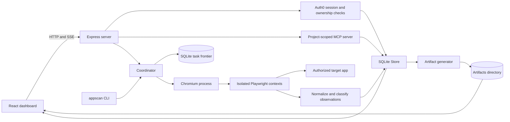
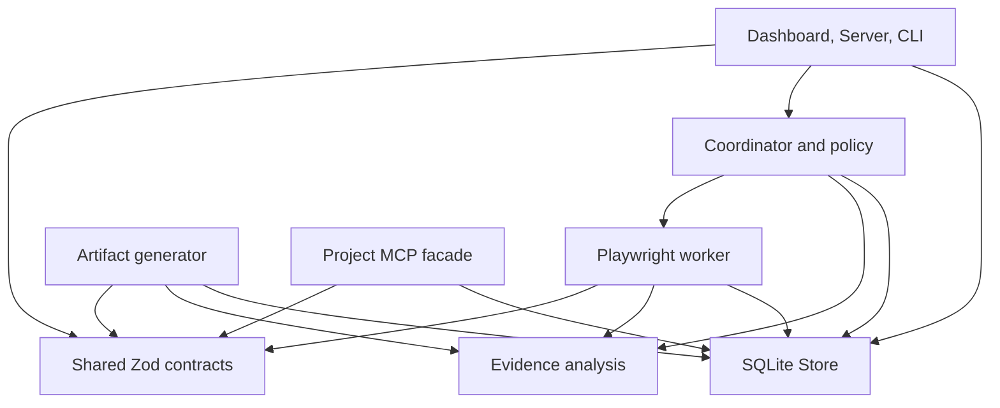
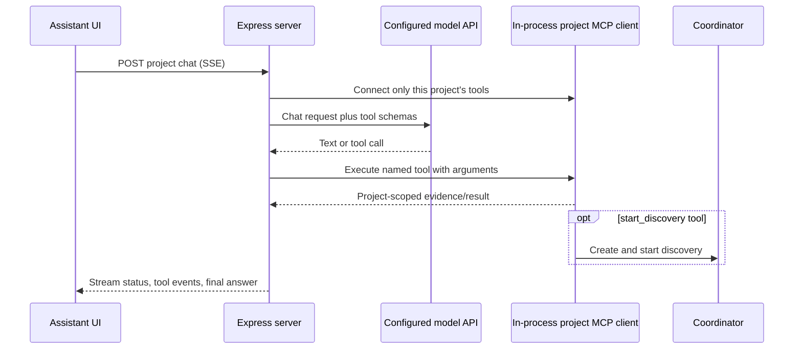

# System design

This guide describes the runtime topology and the responsibilities of each layer. It complements the [platform guide](platform-guide.md) and [discovery engine guide](discovery-engine.md).

## Design goals

The architecture is shaped by five requirements:

1. A UI claim should link back to evidence captured from a live browser.
2. Each discovery should resume after a process interruption without losing already committed work.
3. A worker should only act on a state it has successfully restored and a control it has resolved uniquely.
4. Project data and assistant tools should stay within one authenticated project boundary.
5. The V1 runtime should stay deployable as a single Node process and a single local database.

The current implementation is deliberately a single-host system. It uses parallel browser contexts within a process, not a distributed queue or remote worker fleet.

## Runtime topology

### Development and production

In development, Vite serves the dashboard at port `5173`; the Node server serves the API at `4310`; Atlas runs at `4174`. The Vite config proxies API calls to the server. `npm run dev` builds the engine and runs these three processes together.

In production, `npm run build` compiles the engine and bundles the dashboard. `npm start` runs the server, which serves both the API and `dist/dashboard`. Docker builds Chromium and system dependencies into the app image and exposes ports `4310` and `4174`; compose currently binds them to loopback for local use.

## Layer ownership and dependency direction

| Layer                | Owns                                                                                   | Should not own                            |
| -------------------- | -------------------------------------------------------------------------------------- | ----------------------------------------- |
| `packages/shared`    | Runtime schemas, defaults, and domain types                                            | Browser execution or persistence          |
| `packages/core`      | Run lifecycle, leasing, expansion, budgets, policy, resource response                  | HTTP routes or UI presentation            |
| `packages/worker`    | Chromium contexts, navigation/replay, capture, interaction, network/browser evidence   | Project authorization or dashboard state  |
| `packages/analysis`  | URL/stable-text normalization, fingerprints, equivalence, effects, locator expressions | Browser control or durable writes         |
| `packages/storage`   | SQLite tables, transactions, indexes, migrations, owner-scoped queries                 | Policy decisions or UI behavior           |
| `packages/generator` | Generated code, JSON exports, HTML report                                              | Changing discovery results                |
| `packages/mcp`       | Project-scoped tools/resources/prompts and MCP transports                              | Access to unrelated project evidence      |
| `apps/server`        | Authentication, HTTP contracts, orchestration, streaming, serving files                | Reimplementing worker policy              |
| `apps/cli`           | Local command parsing and direct orchestration                                         | Dashboard authentication/session behavior |
| `apps/dashboard`     | Navigation, settings, graph/catalog/evidence views, assistant UI                       | Direct database access                    |

Packages are imported by source-relative paths in this monorepo. `tsconfig.engine.json` compiles server, CLI, packages, and scripts together; Vite bundles the frontend separately.

## API and identity flow

The Express server validates Host and Origin headers and requires JSON for mutations. Public health and Auth0 routes are registered before the `/api` authentication middleware. Authenticated requests use the verified Auth0 subject as the owner ID. Project queries filter by owner; discovery reads go through their project relationship. The MCP handler also checks that every requested discovery belongs to its project.

Auth0 performs Universal Login and token issuance. The server validates the callback, encrypts token/session data in SQLite, and returns a random HttpOnly, SameSite cookie. The signing/encryption secret must be private and consistent across restarts. Without Auth0 configuration, authenticated `/api` routes return a configuration error; the web dashboard is not an anonymous mode.

The server groups HTTP routes into settings, projects, project assistant/MCP, discoveries, runs, and generated artifact access. The complete route definitions are in `apps/server/src/index.ts`; schemas in `packages/shared` describe request and response records.

## Assistant and MCP request flow

For each chat request, the server creates an in-process MCP client/server pair for the selected project, lists its tools, maps them to OpenAI-compatible function schemas, and sends them with the conversation to the configured model API. The tool loop is bounded to eight model iterations. The assistant UI streams status and tool events using server-sent events. A discovery tool starts work asynchronously; the browser view reads live discovery state separately. Assistant conversation sessions are project-keyed in browser local storage, not stored as server conversations.

The project MCP endpoint uses Streamable HTTP without a persistent MCP session ID. The CLI can expose the same project tools over stdio. Read tools are evidence access; `start_discovery` is the operation that starts browser work. Generated tests/prompts are assistant text and are not executed as shell commands by this app.

## Persistence and artifacts

`Store` uses Node `node:sqlite` `DatabaseSync` in WAL mode. The default database is `.local/unfold.sqlite`; database and artifact roots can be overridden independently with `UNFOLD_DATA_DIR` and `UNFOLD_ARTIFACT_DIR`.

The database has records for projects, runs, states, elements, components, actions, API calls, task leases, events, user preferences, Auth0 sessions, and Auth0 transactions. Domain payloads are JSON serialized into rows; the task frontier, state fingerprint, project ownership, and run/project relationship have relational keys/indexes for uniqueness and query paths. Important transaction boundaries are:

- Project/run creation stores an ownership relationship.
- Task leasing is transactional so two coordinators do not lease the same pending row.
- Observation commits write graph evidence and task completion together.
- Auth state transactions are consumed once.

Artifacts are separate files under `artifacts/<discovery-id>/`: evidence JSON, screenshots, sanitized traces, generated page/component TypeScript, a manifest, and a standalone report. SQLite contains the durable task and evidence index; the artifact directory contains larger files. Both need backup/restore planning.

One host/runtime should write to a database. SQLite plus a filesystem artifact store is a deliberate simple V1 seam; it is not suitable for multiple independent app instances sharing a network filesystem. A future multi-host design needs a shared transactional database, external artifact storage, centralized leasing, and explicit ownership/locking semantics.

## Extension points and trade-offs

- **New persisted evidence:** define and validate the shape in `packages/shared`, add storage/write/query paths, then surface it in exports, MCP, or the dashboard as required.
- **New browser probe:** implement capture and bounded values in `packages/worker`, classification in `packages/analysis` if needed, and a fixture scenario that demonstrates it.
- **New safety rule:** put the decision in `packages/core/src/policy.ts`; record the rule/reason and test the policy independently from the browser.
- **New dashboard lens:** use existing `RunData` evidence; label computed matches as inferred and link back to source state/action IDs.
- **Distributed execution:** replace in-process scheduling/SQLite leases as a coordinated design change; merely running a second server against the same SQLite file is not a safe scale-out path.

See [discovery engine](discovery-engine.md) for task behavior and [architecture decisions and limits](architecture.md) for replay, fingerprinting, evidence, and scope trade-offs.
